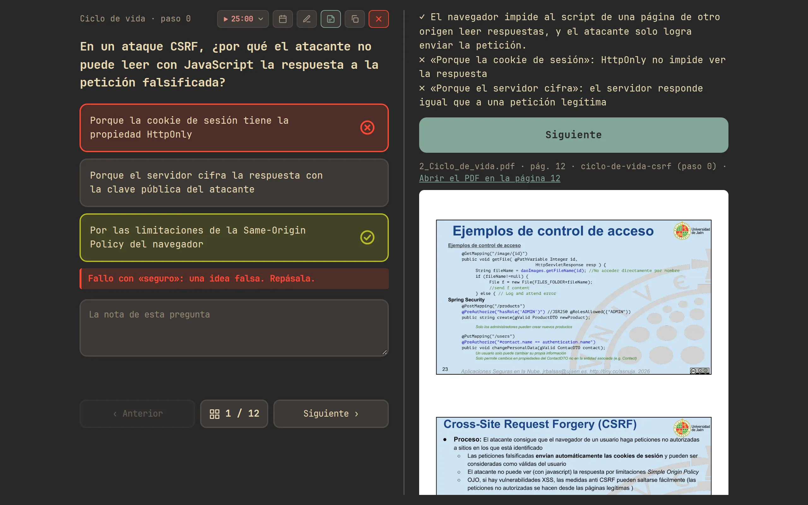

# Exámenes

Una app para preparar exámenes tipo test de la universidad. Cada pregunta sale de una diapositiva del temario, y la solución enseña esa página y explica cada opción. La app reparte las preguntas en sesiones de 12 y vuelve a las falladas y a las vencidas hasta que las sabes.


En cada pregunta, tocas el texto de una opción si estás seguro, o «dudo» si no lo estás. Un fallo con «seguro» marca una idea falsa, y la app la repasa antes.




Cada carpeta de `examenes/` es un examen, con su banco de preguntas y las páginas del temario. Los PDFs de `examenes/asn/` y `examenes/ps/` están en git, y la app los abre en la página de cada pregunta. El vocabulario de la app está en [`GLOSSARY.md`](GLOSSARY.md).

## Instalar

Necesitas [Rust](https://rustup.rs) y Node 22 o más nuevo, con `npm`. `instalar.sh` instala el resto, y dice qué falta del sistema para crear un examen.

```bash
git clone https://github.com/jfdg01/examenes.git
cd examenes
./instalar.sh
```

## Arrancar

```bash
cd app/interfaz && npm run build
cd .. && cargo run --release -p servidor
```

Abre `http://127.0.0.1:8602` y elige un examen. Tus respuestas y tus notas se guardan en la carpeta de cada examen, fuera de git.

Para abrir la app desde el móvil, publícala en tu tailnet con `tailscale serve --bg --https=8601 http://127.0.0.1:8602`.

## Crear un examen nuevo

Un agente de código, como Claude Code, escribe las preguntas con las reglas de [`docs/BANCO.md`](docs/BANCO.md). Para un examen entero, el agente sigue [`docs/LOTE.md`](docs/LOTE.md): un agente creador y un agente revisor por apartado, en paralelo. Antes, prepara la carpeta del examen. Los comandos necesitan `poppler` y `ffmpeg`.

1. Crea una carpeta en `examenes/`, como `examenes/redes/`, y pon los PDFs del temario en `examenes/redes/pdfs/`.
2. Copia `examenes/ps/examen.json` a `examenes/redes/examen.json`, y cambia el título, los PDFs y sus apartados.
3. Crea `examenes/redes/preguntas.json` con una lista vacía: `[]`.
4. Saca el texto y las imágenes de cada página:

```bash
cargo run --manifest-path app/Cargo.toml -p banco -- paginas examenes/redes
```

5. Pide al agente que escriba el examen `examenes/redes` siguiendo `docs/LOTE.md`.

> [!WARNING]
> Un examen entero gasta muchos tokens. Cada apartado lanza un creador y un revisor, y cada uno lee todas las páginas de su PDF, también las imágenes. Empieza con un solo apartado para ver el gasto.

El examen aparece en la lista de la app sin reiniciar el servidor.

El código, los tests y el hook de git están en [`app/README.md`](app/README.md).
