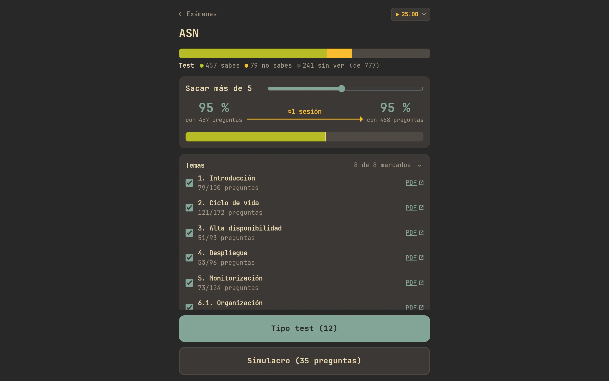
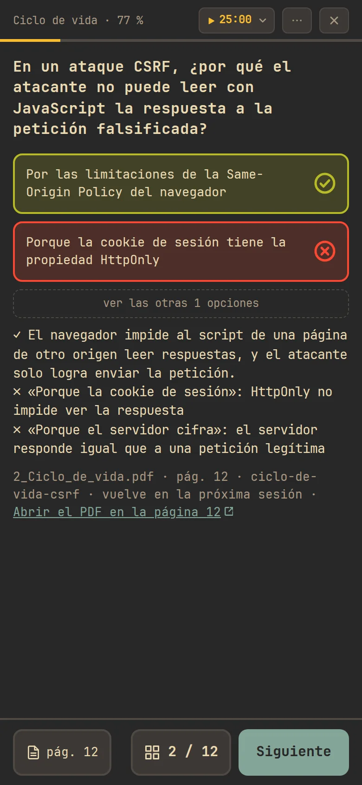

# Exámenes

Una app para preparar exámenes tipo test de la universidad. Cada pregunta sale de una diapositiva del temario, y la solución enseña esa página y explica cada opción. La app reparte las preguntas en sesiones de 12 y vuelve a las falladas y a las vencidas hasta que las sabes.



En cada pregunta, tocas el texto de una opción si estás seguro, o «dudo» si no lo estás. Un fallo con «seguro» marca una idea falsa, y la app la repasa antes.




Cada carpeta de la raíz es un examen, con su banco de preguntas y las páginas del temario. Los PDFs de `asn/` y `ps/` están en git, y la app los abre en la página de cada pregunta. El vocabulario de la app está en [`GLOSSARY.md`](GLOSSARY.md).

## Instalar

Necesitas [Rust](https://rustup.rs) y Node 22 o más nuevo, con `npm`.

```bash
git clone https://github.com/jfdg01/examenes.git
cd examenes
rustup target add wasm32-unknown-unknown
cargo install wasm-bindgen-cli --version 0.2.130
```

## Arrancar

```bash
cd app/interfaz && npm install && npm run build
cd .. && cargo run --release -p servidor -- .. 127.0.0.1:8602
```

Abre `http://127.0.0.1:8602` y elige un examen. Tus respuestas y tus notas se guardan en la carpeta de cada examen, fuera de git.

Para abrir la app desde el móvil, publícala en tu tailnet con `tailscale serve --bg --https=8601 http://127.0.0.1:8602`.

El código, los tests y el hook de git están en [`app/README.md`](app/README.md).
