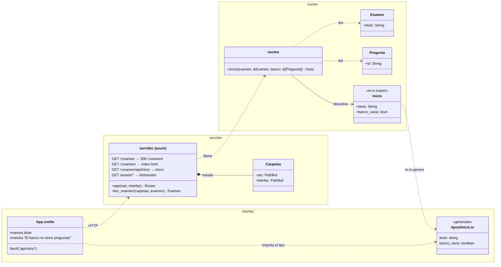

# El diagrama de la app

El diagrama de clases de `app/`: los tipos de `nucleo`, el servidor y la interfaz, y cómo se llaman. Un cambio de un tipo, una ruta o una dependencia entre las 3 partes actualiza este diagrama en el mismo commit.

